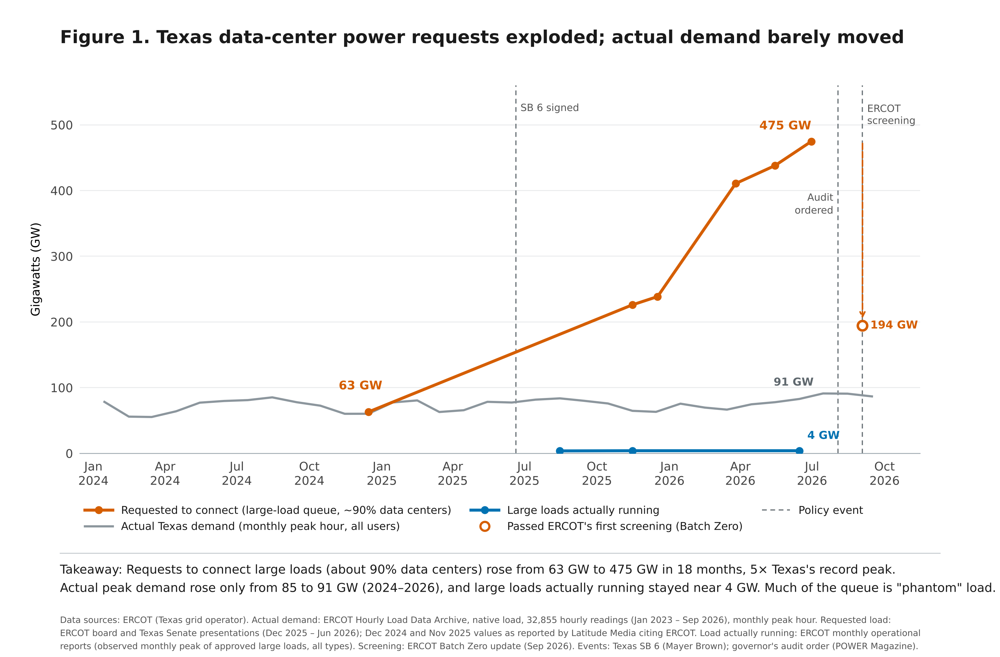

# Phantom load: Texas data-center power requests vs actual demand

**Question:** Can AI efficiency keep pace with growing use and the shift to energy-hungry reasoning, and are grid requests for data-center power consistent with what AI actually uses?

**Finding:** Requests to connect large loads to ERCOT, the Texas grid operator, rose from 63 GW (Dec 2024) to 475 GW (Jun 2026). About 90% of these requests come from data centers, and 475 GW is about 5× Texas's record peak demand. Over the same period:
- actual peak demand, calculated from 32,855 hourly readings, rose only from 85 to 91 GW;
- large loads actually running stayed near 4 GW;
- ERCOT's first screening (Batch Zero) kept only 194 GW.

On the AI side, measured benchmark data show a long reasoning answer uses ~17× the energy of a chat answer. Meanwhile, Google reports a 33× drop in energy per prompt in one year. At measured efficiency, 1 GW runs about 16 billion long reasoning answers a day, more than 6× ChatGPT's daily traffic.



Midterm data-visualization assignment, Energy Economics, Johns Hopkins SAIS (fall 2026). Two-minute voiceover script: [`voiceover.md`](voiceover.md).

## Repository contents

| Path | What it is |
|---|---|
| `figures/phantom_load_timeline.png` / `.pdf` | Final figure |
| `data/phantom_load_raw_data.csv` | **All raw data in one file** (32,990 rows; no calculated values) |
| `data/phantom_load_data.xlsx` | Tab *Raw data* (same as the CSV) + tab *Calculations* (every derived number as an Excel formula pointing at raw cells) |
| `data/figure1_data.csv` | Exactly the values plotted in Figure 1 |
| `data/phantom_load_dataset.csv` | Source records compiled from ERCOT, company and news documents (input to the scripts) |
| `data/ercot_monthly_demand.csv` | Monthly peak and average demand computed from the hourly data |
| `raw/ercot_hourly/` | Original ERCOT Hourly Load Data Archive files, 2023 to Sep 2026 (`manifest.json` has SHA-256 checksums) |
| `raw/ml_energy/` | Original ML.ENERGY Leaderboard v3 benchmark files for Qwen3 8B/14B/32B (`manifest.json` has source URLs and checksums) |
| `voiceover.md` | Two-minute script |

### `phantom_load_raw_data.csv` columns
`row_id, section, item, date, date_precision, hour_ending, dst_repeat_hour, value, unit, bench_*, zone_*_MW, source, url`

- `date` is always `YYYY-MM-DD`. `date_precision` says whether it refers to an hour, day, month or quarter. Month-only values use the 1st of the month; quarters use the quarter's first day.
- Hourly rows: `hour_ending` is 1–24 (ERCOT convention, Central Prevailing Time). `dst_repeat_hour` = `yes` marks the repeated hour when daylight saving time ends. `value` is the ERCOT system total and `zone_*_MW` are the eight weather zones.
- Benchmark rows: `value` is GPU energy per response (J). The `bench_*` columns hold model, task, GPU, batch size, energy per token, output length, power, throughput and latency.

| Section | Rows | Source |
|---|---|---|
| 1. ERCOT large-load queue (requested load) | 15 | ERCOT board and Senate presentations; Latitude Media citing ERCOT for Dec 2024 and Nov 2025 |
| 2. ERCOT large loads actually running | 9 | ERCOT monthly operational reports, TAC report |
| 3. ERCOT Batch Zero screening | 3 | ERCOT Batch Zero update (Sep 2026) |
| 4. ERCOT peak demand records | 14 | ERCOT peak demand records |
| 5. Policy events | 3 | Mayer Brown (SB 6), POWER Magazine (audit order), ERCOT |
| 6. AI energy and usage | 5 | Google Cloud (Aug 2025), Sam Altman (Jun 2025), TechCrunch/OpenAI (Jul 2025) |
| 7. ML.ENERGY benchmark runs | 86 | ML.ENERGY Leaderboard v3, GitHub commit 2bdd00701869 |
| 8. ERCOT hourly load | 32,855 | [ERCOT Hourly Load Data Archive](https://www.ercot.com/gridinfo/load/load_hist/index.html) |

## Reproduce

```bash
pip install -r requirements.txt
python build_dataset.py     # compiles source records + benchmark runs -> data/phantom_load_dataset.csv
python ercot_hourly.py      # hourly ERCOT files -> data/ercot_monthly_demand.csv (checks zones sum to total)
python timeline.py          # Figure 1 + data/figure1_data.csv
python build_workbook.py    # data/phantom_load_raw_data.csv + data/phantom_load_data.xlsx
```
`build_workbook.py` writes Excel formulas without cached results. Open the workbook in Excel or LibreOffice (or run a recalculation) to see the computed values.

## Key calculations (tab *Calculations*)
- **Monthly peak demand:** maximum hourly ERCOT load in each month (grey line).
- **Reasoning vs chat:** Qwen3-32B on one NVIDIA B200 (max batch 128), GPQA run energy ÷ LM Arena chat run energy = 16.6×.
- **Full data-center energy per long reasoning answer:** 0.609 Wh GPU × 2.4, where 2.4 is Google's ratio of full data-center energy to active-chip energy (0.24 / 0.10 Wh). Result: 1.46 Wh.
- **Answers per GW:** 1 GW × 24 h ÷ 1.46 Wh ≈ 16.4 billion per day, which is 6.6× ChatGPT's 2.5 billion daily prompts.

## Limitations
- Requested-load totals come from ERCOT presentations; ERCOT does not publish the underlying request list. The Dec 2024 and Nov 2025 values come from a news report citing ERCOT, and lines between data points are straight joins.
- "Actually running" covers all large loads, including crypto mining, measured as the observed monthly peak of approved loads.
- Peak demand also depends on weather.
- Google's and OpenAI's per-prompt figures are self-reported and not independently verified.
- The benchmark compares different tasks (GPQA vs LM Arena), so it is not a controlled reasoning-on/off test.
- ChatGPT is one service; data centers also train models and run cloud workloads. The AI conversions assume full use around the clock and are a scale check, not a demand estimate.

## Licenses
ML.ENERGY benchmark files remain under their original license (`raw/ml_energy/LICENSE`). ERCOT data are public information from ercot.com.
